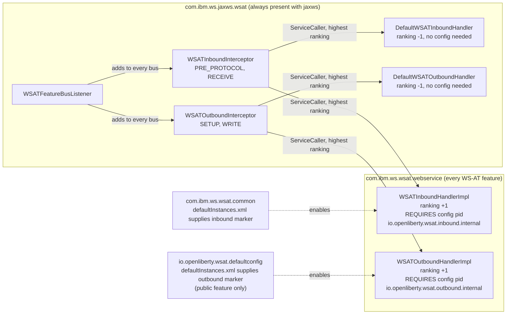

# WS-AT availability: select handlers by configuration, not by feature name

| | |
|---|---|
| **UFO** | 33070 – Conditional WS-AT |
| **Status** | Draft for review |
| **Code** | `open-liberty`, branch `33070-conditional-ws-at`, commits `fd43cfc29ac` (refactor) and `ce2b3b31c2a` (behaviour) |
| **Bundles** | `com.ibm.ws.jaxws.wsat`, `com.ibm.ws.wsat.webservice`, `com.ibm.ws.wsat.common`, `io.openliberty.wsat.defaultconfig` |

## 1. Summary

Today the JAX-WS WS-AT interceptors decide whether WS-AT is available by asking `FeatureProvisioner` whether
particular **feature names** are installed. That list is hard-coded, so every new internal WS-AT feature variant
means editing `WSATFeatureService`, and the "internal only" versus "public" distinction lives in string constants.

This change removes every feature-name check. Instead:

- The inbound and outbound interceptors always sit on the CXF bus and delegate to the **highest-ranked** handler
  service of their kind.
- A **default** handler is always registered with a low `service.ranking`. It does not accept or transmit WS-AT and
  fails exactly as WS-AT does today when it is not installed.
- A **real** handler, with a higher ranking, replaces the default only while a specific marker configuration exists.
  The inbound marker is supplied by the internal WS-AT bundles. The outbound marker is supplied only by the public
  `wsAtomicTransaction-1.2` feature.

For a running server, the intended steady-state behaviour is **unchanged**. What changes is how the decision is made
and what happens in a few edge cases (section 6).

## 2. Motivation

| Problem with the feature-name check | Consequence |
|---|---|
| Hard-coded names: `wsAtomicTransaction-1.2` plus four `io.openliberty.wsAtomicTransaction1.2.internal.*` variants | A new variant, or a rename, silently breaks WS-AT detection |
| `isWSATPresent()` / `isPublicFeaturePresent()` were static methods reading a static `AtomicServiceReference` | Hidden global state, awkward to test, ordering dependent |
| One interceptor class with an `isOut` flag | Inbound and outbound logic interleaved, with four-way condition logic in `handleMessage` |
| `com.ibm.ws.jaxws.wsat` depended on `com.ibm.ws.kernel.feature` | Feature-model knowledge leaked into a JAX-WS bundle |

## 3. Design

### 3.1 Components

### 3.2 Handler contracts (package `com.ibm.ws.jaxws.wsat.components`)

| Interface | Methods | Called from |
|---|---|---|
| `WSATInboundHandler` | `handlePreProtocol(Message)`, `handleReceive(Message)` | `PRE_PROTOCOL` and `RECEIVE` phases |
| `WSATOutboundHandler` | `handleSetup(Message)`, `handleWrite(Message, boolean assertionPresent)` | `SETUP` and `WRITE` phases |

The interceptors (`WSATInboundInterceptor`, `WSATOutboundInterceptor`, in `com.ibm.ws.wsat.policy`) keep the same
phases and ordering anchors as before, and still assert any `wsat:ATAssertion` on every message. They resolve the
handler per message through `ServiceCaller`, which caches the service and drops it on unregister or ranking change.

### 3.3 What each handler does

| Handler | Ranking | Active when | Inbound / outbound behaviour |
|---|---|---|---|
| `DefaultWSATInboundHandler` | -1 | always | `handlePreProtocol`: reject if a WS-AT coordination context header is present. `handleReceive`: nothing. |
| `WSATInboundHandlerImpl` | +1 | config `io.openliberty.wsat.inbound.internal` exists | `handlePreProtocol`: nothing. `handleReceive`: on a SERVER bus, add `SSLServerInterceptor` for the WS-AT application itself, otherwise `CoorContextInInterceptor`. |
| `DefaultWSATOutboundHandler` | -1 | always | `handleSetup`: nothing. `handleWrite`: reject if an AT assertion is present, if the writer contains the WS-AT namespace, or if WS-AT headers are present. |
| `WSATOutboundHandlerImpl` | +1 | config `io.openliberty.wsat.outbound.internal` exists | `handleSetup`: on a CLIENT bus, add `CoorContextOutInterceptor`. `handleWrite`: nothing. |

Every rejection produces `Fault(RuntimeException("WS-AT Feature is not installed"))`. That text is unchanged, because
many FATs assert on it.

### 3.4 Where the marker configuration comes from

| Marker PID | Declared in | Present when |
|---|---|---|
| `io.openliberty.wsat.inbound.internal` | `com.ibm.ws.wsat.common/resources/OSGI-INF/wlp/defaultInstances.xml` | any WS-AT feature, internal or public (all ship `com.ibm.ws.wsat.common`) |
| `io.openliberty.wsat.outbound.internal` | `io.openliberty.wsat.defaultconfig/resources/OSGI-INF/wlp/defaultInstances.xml` | the public `wsAtomicTransaction-1.2` feature only |

The outbound marker deliberately lives in the bundle that already supplies the public-feature default
(`<wsAtomicTransaction propagation="always"/>`). The same public-only bundle therefore gates both the `propagation`
default and the ability to send WS-AT.

No metatype is declared for either marker; the entries in `defaultInstances.xml` are empty elements.

## 4. Behaviour by configuration

| Server has | Inbound WS-AT | Outbound WS-AT | Why |
|---|---|---|---|
| JAX-WS, no WS-AT feature | Rejected | Rejected | only the defaults exist |
| Internal WS-AT feature only (for example T-Rex) | Accepted | Rejected | inbound marker present, outbound marker absent |
| `wsAtomicTransaction-1.2` (public) | Accepted | Sent (subject to `propagation`) | both markers present |

This matches the existing `InternalFeatureOnlyTest` expectation: inbound works and outbound is rejected with only an
internal feature.

The `propagation` attribute (`always` / `check_wsdl`) is **not** touched by this change. It continues to be declared in
the `com.ibm.ws.wsat.common` metatype and defaulted by the public feature.

## 5. What did not change

- The `WSATFeatureBusListener` still registers the policy builder and provider, and the GZIP options, as before.
- Interceptor phases and `before` / `after` ordering anchors.
- The "WS-AT Feature is not installed" fault text and every condition that raises it.
- The `propagation` attribute, its default, and the `CWLIB0212I` handling of dynamic configuration changes.
- No new public API or SPI. Neither `com.ibm.ws.jaxws.wsat` package appears in any `IBM-API-Package` or
  `IBM-SPI-Package` header; both are listed only as bundles in the jaxws and xmlWS feature files.

## 6. Behavioural differences and trade-offs

| # | Difference | Impact |
|---|---|---|
| 1 | **Start-up window fails closed.** Until the real handlers activate, the default handlers reject WS-AT. | A message arriving before DS activates the real handler is rejected with "WS-AT Feature is not installed". Previously the decision was read from the installed-feature set, so the window may be new. I have not measured how long it is or whether inbound traffic can arrive in it; this needs confirming under FAT. |
| 2 | **"Feature present, no interceptor service" error is gone.** The old code threw "WS-AT Feature is present, however there is no interceptor service available" in that state. | That state can no longer occur. If the real handler is not active, the default rejects with the standard message. |
| 3 | **Detection is tied to configuration existence, not feature membership.** | Removing the marker, or the bundle that supplies it, disables the capability. A new internal feature variant must include both `com.ibm.ws.wsat.webservice` and `com.ibm.ws.wsat.common` (all four existing ones do). |
| 4 | **`ServiceCaller` requires OSGi.** `current()` throws `IllegalStateException` outside a framework. | Production is unaffected. Plain JUnit tests of the interceptors would need the fallback path or a mocked framework. |
| 5 | **Dynamic enable/disable.** `ServiceCaller` drops the cached service on unregister or ranking change. | Behaviour follows the DS lifecycle of the real handlers, not a per-message feature lookup. |
| 6 | **Export version** of `com.ibm.ws.jaxws.wsat` and `com.ibm.ws.jaxws.wsat.components` raised from 2.3 to 3.0. | The `components` and `Constants` APIs changed incompatibly (see section 7). Internal consumers (`webclient`, `webservice`, `common`) are rebuilt together; `webclient` resolves to `[3.0,4)`. |

## 7. API removed and added (internal only)

| Removed | Added |
|---|---|
| `WSATFeatureService.isWSATPresent()`, `isPublicFeaturePresent()` and the `FeatureProvisioner` reference | `WSATInboundHandler`, `WSATOutboundHandler` |
| `WSATInterceptorService` and `WSATInterceptorServiceImpl` | `DefaultWSATInboundHandler`, `DefaultWSATOutboundHandler` |
| `WSATPolicyAwareInterceptor` (with its `isOut` flag) | `WSATInboundInterceptor`, `WSATOutboundInterceptor`, `AbstractWSATPolicyInterceptor`, `WSATNotInstalled` |
| `Constants.FEATURE_WSAT_NAME`, `Constants.WS_INTERCEPTOR_CLASSNAME` | `WSATInboundHandlerImpl`, `WSATOutboundHandlerImpl`; `Constants.WS_INBOUND_INTERCEPTOR_CLASSNAME` |

`WSATFeatureService` is renamed `WSATBusSetup`, because its only remaining job is to register
`WSATFeatureBusListener` with `LibertyApplicationBusFactory` so that the interceptors are added to each new bus. It no
longer reports whether WS-AT is present. Nothing else references the class. The rename is its own commit, `752c25b9dc3`.

## 8. Alternatives considered

| Option | Why not |
|---|---|
| Keep the feature-name check, add the new internal variants | Perpetuates the hard-coded list this change is removing |
| One handler service per direction, no default | Needs a "no service" branch in the interceptor with duplicated rejection logic; the default handler makes the absent case an ordinary service |
| Condition on a single marker for both directions | Cannot express "inbound without outbound" for internal-only features |
| Declare the markers with a metatype | Not needed for an empty marker configuration; see open item 1 |

## 9. Validation status

| Check | Result |
|---|---|
| Build of `com.ibm.ws.jaxws.wsat`, `com.ibm.ws.wsat.webservice`, `com.ibm.ws.wsat.webclient`, `com.ibm.ws.wsat.common`, `io.openliberty.wsat.defaultconfig` | Passes |
| `com.ibm.ws.wsat.common` unit tests | Pass |
| Generated DS XML | Default handlers: ranking -1, `configuration-policy="ignore"`. Real handlers: ranking +1, `configuration-policy="require"` with the marker PIDs. |
| **Live server / FATs** | **Not yet run** |

## 10. Open items before wider rollout

1. **Marker configuration without a metatype.** Confirm on a running server that an empty `<io.openliberty.wsat.*.internal/>`
   entry in `defaultInstances.xml`, with no metatype, creates a configuration that satisfies
   `configurationPolicy = REQUIRE`, and produces no config warning. Other bundles that use marker configs declare a
   metatype; this design does not. This is the main unverified assumption.
2. Run the WS-AT FATs, in particular `InternalFeatureOnlyTest` (inbound works, outbound rejected) and the
   `"WS-AT Feature is not installed"` checks in `WSATAssertionTest`, `ServiceIOTest` and `PolicyAttachmentTest`.
3. Measure or reason about the start-up window in section 6, item 1.
4. Decide whether `@Version` in the two `package-info.java` files (still `1.0.16`) should be aligned with the `3.0`
   export version. The explicit `bnd.bnd` version takes precedence today.

## 11. Terminology note

The slide deck refers to an internal feature named `com.ibm.ws.wsat.internal`. In the code the internal features are
`io.openliberty.wsAtomicTransaction1.2.internal.{ee-6.0, ee-9.0, ee-10.0, jaxws-2.2}`, and the public feature
`wsAtomicTransaction-1.2` includes `internal.ee-6.0` together with `io.openliberty.wsat.defaultconfig`.
